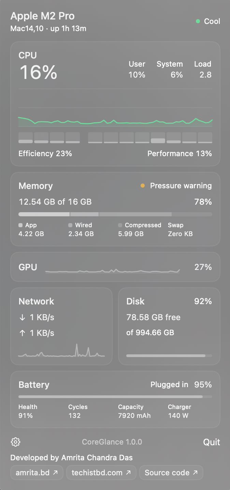

# CoreGlance

A lightweight menu bar system monitor for Mac. It shows your Mac's health at a glance, built for Apple Silicon (M1 and later) with Swift and SwiftUI.

- **Light:** about 1% of one CPU core and about 20 MB of memory.
- **Private:** no analytics, no account. The only network request is an optional once-a-day check for a new version.
- **Small:** about 2,200 lines of code, no third-party dependencies.

<p align="center"></p>

## What it shows

| | |
|---|---|
| **CPU** | Total, user, system, idle, load average, a live graph, and per-core bars split into efficiency and performance cores |
| **Memory** | Used / total, app, wired, compressed, swap, and the macOS memory pressure level (Normal / Warning / Critical) |
| **GPU** | Utilization with a live graph |
| **Network** | Download and upload speed of your internet connection, in bytes or bits. Click the card for the data you have used: today, this week, this month and this year, with charts for the last 24 hours and 30 days |
| **Disk** | Free and total space on the startup disk, with a low-space warning |
| **Battery** | Charge, health (current vs design capacity), cycle count, time remaining, charger wattage, and live power: watts the Mac is using, watts from the charger, and watts going into or out of the battery |
| **Thermal** | The macOS thermal state (Cool / Warm / Hot / Critical) |
| **Temperature and fans** | Optional, off by default: chip temperature and the speed of each fan |
| **Top processes** | Top 6 by CPU or memory |

The menu bar item can show any mix of CPU, RAM, GPU and network speed, either on one line or in a compact two-line layout.

Optional alerts notify you when memory pressure turns critical, the disk is nearly full, or the Mac is overheating.

## Install

**Requirements:** an Apple Silicon Mac with macOS 14 or later.

### Homebrew

```bash
brew install --cask amritadasbijoy/tap/coreglance
```

Then open CoreGlance from your Applications folder. It is not notarized by Apple, so macOS blocks it the first time: open **System Settings → Privacy & Security**, scroll down and click **Open Anyway**.

To update later, run `brew upgrade --cask coreglance`.

### Download

1. Download `CoreGlance-<version>.dmg` from the [Releases](../../releases) page and open it.
2. Drag `CoreGlance` onto the Applications folder in the window that appears, then open it from Applications.
3. The app is not notarized by Apple, so macOS blocks it the first time. Open **System Settings → Privacy & Security**, scroll down and click **Open Anyway**.

### Build from source

You only need the Xcode Command Line Tools (`xcode-select --install`).

```bash
git clone https://github.com/amritadasbijoy/CoreGlance.git
cd CoreGlance
./build.sh install
```

This builds the app and copies it to `~/Applications/CoreGlance.app`.

## Settings

Click the gear icon at the bottom of the popup to open the settings page:

- Refresh interval: 1, 2, 5 or 10 seconds
- Appearance: follow the system, or always light or dark
- What the menu bar shows, and the compact two-line style
- Top processes on or off
- Temperature and fan speed on or off (the temperature can also go in the menu bar)
- Network speed in bytes or bits
- Alerts
- Check for updates on or off
- Launch at login

## Updates

Once a day CoreGlance asks GitHub whether a newer release exists. If there is one, the popup shows a line with a download link (or the Homebrew command), and you get one notification for that version. The app never downloads or installs anything by itself.

The check is the app's only network request. It sends nothing about you or your Mac; GitHub sees your IP address, as any website does. Turn it off in Settings with **Check for updates once a day**.

## How it stays light

- One timer drives everything, with tolerance so macOS can group wakeups.
- Battery and disk are read every 30 seconds, not on every tick.
- The process list is only read while the popup is open.
- Data usage reuses the network counters already read for the speed, and is saved at most once a minute.
- The popup is not redrawn at all while it is closed.
- The menu bar item is redrawn only when its text changes.

## Limits

- **Temperature and fan speed are optional and off by default.** macOS has no public API for them on Apple Silicon, so CoreGlance reads them through undocumented interfaces (the HID temperature sensors and the SMC). They may be missing on some Macs or stop working after a macOS update; the official thermal state is always shown. The temperature is the hottest sensor on the chip.
- **Live power figures are missing on some Macs.** They come from an undocumented battery report that macOS refreshes about once a minute, so they lag a little. If a Mac does not provide them, that line is hidden.
- **Data usage is counted by CoreGlance itself.** macOS keeps no history, so the count starts when you first run this version and pauses while the app is not running. It covers this Mac only, so it will not match your provider's figure. The totals live in `~/Library/Application Support/CoreGlance/usage.json` and never leave your Mac.
- **Top processes lists your own processes only.** System processes such as WindowServer need administrator rights, which CoreGlance never asks for.
- **Network speed is measured on the interface that carries your internet connection** (Wi-Fi, Ethernet, tethering or a full VPN). Other interfaces are ignored, and it reads zero when offline. Transfers to devices on the same local network use that same interface, so they are included.
- **Not on the Mac App Store.** The App Store sandbox blocks the process list.

## Development

```bash
swift build          # compile
swift test           # run the tests (needs Xcode, not just the Command Line Tools)
./build.sh           # build build/CoreGlance.app
./build.sh release   # also create the dmg and zip for a release
swift scripts/make-icon.swift   # regenerate the app icon

# Draw the popup to a PNG without clicking the menu bar (handy for checking layout changes):
COREGLANCE_SNAPSHOT=/tmp/popup.png build/CoreGlance.app/Contents/MacOS/CoreGlance
```

| File | Purpose |
|---|---|
| `Sources/CoreGlance/Sensors.swift` | Reads the system (Mach, IOKit, sysctl) |
| `Sources/CoreGlance/Thermals.swift` | Optional temperature and fan readings (undocumented interfaces) |
| `Sources/CoreGlance/Usage.swift` | The internet data usage log and its file |
| `Sources/CoreGlance/UsageView.swift` | The data usage page |
| `Sources/CoreGlance/Updates.swift` | The once-a-day check for a new release |
| `Sources/CoreGlance/Core.swift` | Pure calculations and formatting, covered by tests |
| `Sources/CoreGlance/Monitor.swift` | The sampling timer, menu bar image and alerts |
| `Sources/CoreGlance/Views.swift` | The popup interface |
| `Sources/CoreGlance/App.swift` | App entry point and menu bar item |

To publish a release, push a tag such as `v1.0.0`. The GitHub Action builds the app and attaches the dmg and zip to a new release. It then updates the Homebrew cask in [homebrew-tap](https://github.com/amritadasbijoy/homebrew-tap) by itself. If that step ever fails, run the "Update Homebrew cask" workflow by hand from the Actions tab.

## Author

Developed by **Amrita Chandra Das** · [amrita.bd](https://amrita.bd) · [techistbd.com](https://techistbd.com)

## License

[MIT](LICENSE)
