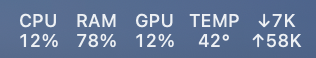
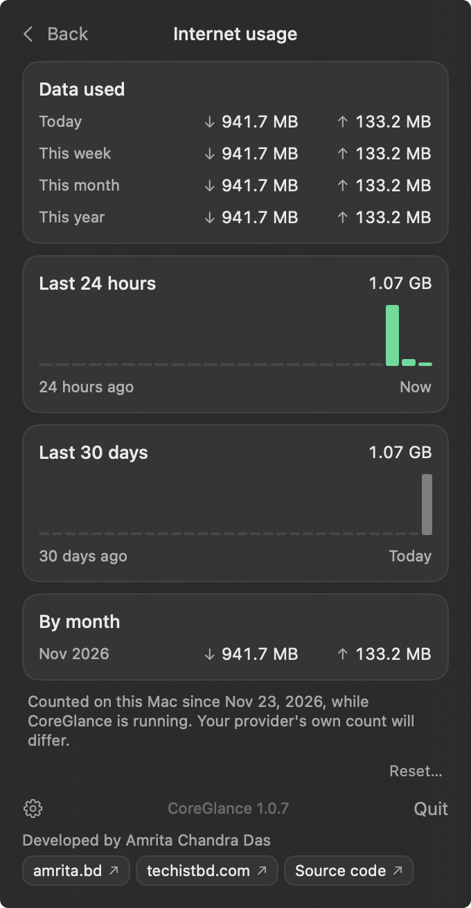
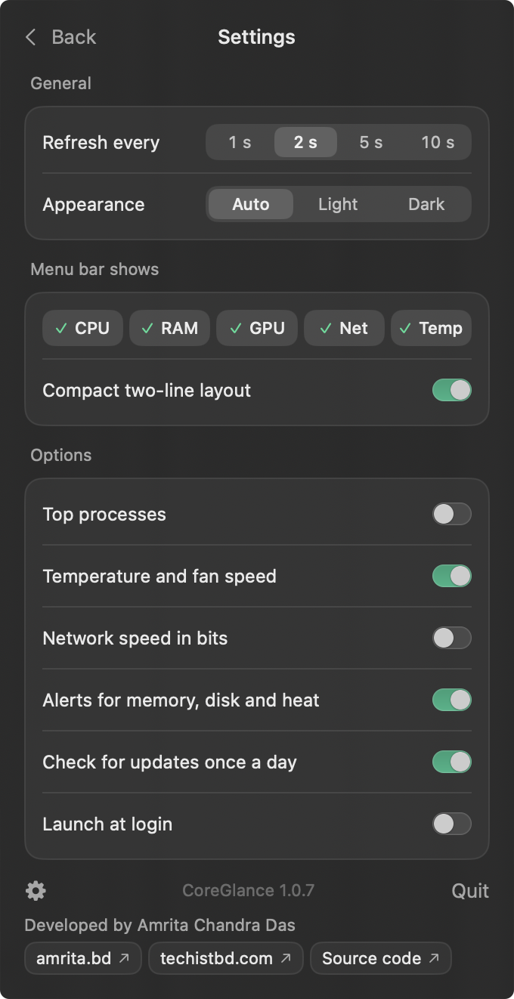

# CoreGlance

A lightweight menu bar system monitor for Mac.

CoreGlance sits in your menu bar and shows how your Mac is doing: how busy the processor is, how much memory is in use, how fast your internet is, how much battery is left, and more. Click it to see the details.

It is built for Apple Silicon Macs (M1 and later) with Swift and SwiftUI.

- **Light:** about 1–2% of one CPU core and 20–40 MB of memory.
- **Private:** no analytics, no account, no tracking. The only network request is an optional once-a-day check for a new version.
- **Small:** about 2,300 lines of code, no third-party dependencies.
- **Free and open source:** MIT license.

<p align="center"></p>

## Contents

- [Install](#install)
- [First launch](#first-launch)
- [The menu bar item](#the-menu-bar-item)
- [The popup, card by card](#the-popup-card-by-card)
- [Internet usage page](#internet-usage-page)
- [Settings](#settings)
- [Alerts](#alerts)
- [Updates](#updates)
- [Privacy](#privacy)
- [Questions and answers](#questions-and-answers)
- [Uninstall](#uninstall)
- [For developers](#for-developers)

## Install

**You need:** a Mac with an Apple Silicon chip (M1 or later) and macOS 14 or later.

Pick one of the three ways below.

### Option 1: Download (easiest)

1. Open the [Releases](../../releases/latest) page and download `CoreGlance-<version>.dmg`.
2. Open the downloaded file. A window appears with CoreGlance and an Applications folder.
3. Drag **CoreGlance** onto the **Applications** folder.
4. Open CoreGlance from your Applications folder, then follow [First launch](#first-launch).

### Option 2: Homebrew

If you use [Homebrew](https://brew.sh), run:

```bash
brew install --cask amritadasbijoy/tap/coreglance
```

Then open CoreGlance from your Applications folder and follow [First launch](#first-launch).

### Option 3: Build it yourself

You only need the Xcode Command Line Tools (`xcode-select --install`).

```bash
git clone https://github.com/amritadasbijoy/CoreGlance.git
cd CoreGlance
./build.sh install
```

This builds the app and copies it to `~/Applications/CoreGlance.app`. A copy you build yourself opens without the warning described below.

## First launch

CoreGlance is not notarized by Apple (that needs a paid Apple Developer account). So the first time you open a downloaded copy, macOS blocks it. You only have to do this once:

1. Open CoreGlance. macOS says it cannot be opened. Close that message.
2. Open **System Settings → Privacy & Security**.
3. Scroll down. You will see a line about CoreGlance being blocked. Click **Open Anyway**.
4. Confirm with your password or Touch ID.

CoreGlance has no window and no Dock icon. It appears only in the menu bar, at the top right of your screen.

To make it start by itself every time you log in, open the popup, click the gear icon, and turn on **Launch at login**.

## The menu bar item

<p align="center"></p>

The menu bar item shows live numbers so you can see them without clicking anything. You choose which ones in [Settings](#settings):

| Label | Meaning |
|---|---|
| **CPU** | How busy the processor is, in percent |
| **RAM** | How much memory is in use, in percent |
| **GPU** | How busy the graphics chip is, in percent |
| **TEMP** | Chip temperature (needs the temperature option, see below) |
| **↓ ↑** | Internet download and upload speed |

By default it shows CPU and RAM in a compact two-line layout. You can also show them on one line. If you turn everything off, a small pulse icon is shown instead.

Click the item to open the popup. Click anywhere else to close it.

## The popup, card by card

### Header

The name of your chip, your Mac model and how long the Mac has been running since the last restart. On the right is the **thermal state** that macOS reports:

| State | Meaning |
|---|---|
| **Cool** | Normal |
| **Warm** | Getting warm; nothing to do |
| **Hot** | macOS is slowing things down to cool off |
| **Critical** | Very hot; the Mac is heavily slowed down |

### CPU

- The big number is the total processor use.
- **User** is work done by your apps. **System** is work done by macOS itself.
- **Load** is the load average: roughly how many tasks are waiting for the processor.
- The graph shows the last 60 readings (two minutes at the default refresh rate).
- The small bars show each core. Apple Silicon has two kinds: **efficiency** cores (slower, save power) and **performance** cores (fast). The two groups have their own average below the bars.

### Memory

- How much memory is in use, out of the total.
- **App** is memory used by your apps. **Wired** is memory macOS cannot move. **Compressed** is memory macOS has squeezed to make room. **Swap** is memory that was moved to the disk.
- **Pressure** is the most useful value. It is how macOS itself judges memory: **Normal**, **Warning** or **Critical**. A high percentage with normal pressure is fine. Warning or critical means the Mac would run better with fewer apps open.

### GPU

How busy the graphics chip is, with a live graph.

### Temperature (optional)

Off by default. Turn on **Temperature and fan speed** in Settings to see:

- The chip temperature. This is the hottest sensor on the chip. It follows the Celsius or Fahrenheit choice in your macOS settings.
- The speed of each fan in rpm. `0 rpm` is normal: MacBook fans stop completely when the Mac is cool. Macs without fans (such as the MacBook Air) show no fan speed.

### Network

Your current internet download and upload speed, with a small graph. Click this card to open the [Internet usage page](#internet-usage-page).

The speed is measured on the connection that carries your internet (Wi-Fi, Ethernet, phone tethering or a full VPN). It shows **Offline** and zero when there is no connection.

### Disk

Free and total space on your startup disk. The number turns amber when less than 25 GB is free and red when less than 10 GB is free.

### Battery

Shown on Macs with a battery.

| Value | Meaning |
|---|---|
| **Percent** | Current charge. Amber at 20% or less, red at 10% or less, when not plugged in |
| **Health** | How much charge the battery can hold now, compared with when it was new |
| **Cycles** | How many full charge cycles the battery has been through |
| **Time left / Full in** | Time until empty on battery, or until full while charging |
| **Capacity** | Current full capacity in mAh (shown when there is no time to show) |
| **Charger** | The wattage of the connected charger |
| **Using** | Watts the whole Mac is using right now |
| **From charger** | Watts the charger is delivering right now |
| **From battery / To battery** | Watts leaving the battery, or going into it while charging |

"Not charging" while plugged in is normal. macOS often holds the battery below 100% to protect it.

The watt values are refreshed by macOS about once a minute, so they react a little late when you plug in or unplug.

### Top processes (optional)

The six apps or processes using the most CPU or the most memory. Switch between the two with the **CPU / Memory** buttons. It lists only your own processes, not system ones.

### Footer

The gear icon opens Settings. **Quit** closes CoreGlance. When a newer version exists, a card above the footer tells you (see [Updates](#updates)).

## Internet usage page

<p align="center"></p>

Click the **Network** card to see how much internet data this Mac has used.

- **Data used:** download (↓) and upload (↑) for today, this week, this month and this year.
- **Last 24 hours:** one bar per hour.
- **Last 30 days:** one bar per day.
- **By month:** a list of up to 12 months.
- **Reset…** deletes the whole history, after asking you to confirm.
- **Back** returns to the main page.

Good to know:

- macOS keeps no history of this, so CoreGlance counts it itself. Counting starts the first time you run version 1.0.5 or later. The start date is shown at the bottom of the page.
- It only counts while CoreGlance is running. Turn on **Launch at login** so it never misses anything.
- It counts this Mac only, not your phone or other devices. So it will not match the number from your internet provider.
- Copying files to another device on the same Wi-Fi is counted too, because it travels over the same connection.
- Units are the ones providers use: 1 GB = 1000 MB.

## Settings

<p align="center"></p>

Open the popup and click the gear icon at the bottom left.

| Setting | What it does | Default |
|---|---|---|
| **Refresh every** | How often the numbers update: 1, 2, 5 or 10 seconds. Longer uses less power | 2 s |
| **Appearance** | Auto follows macOS; Light and Dark force one look for the popup | Auto |
| **Menu bar shows** | Which values appear in the menu bar: CPU, RAM, GPU, Net, Temp | CPU and RAM |
| **Compact two-line layout** | Label above value, which takes less width. Off puts everything on one line | On |
| **Top processes** | Shows the Top processes card | On |
| **Temperature and fan speed** | Shows the Temperature card | Off |
| **Network speed in bits** | Shows speed in Mbps instead of MB/s | Off |
| **Alerts for memory, disk and heat** | Sends a notification for the problems listed under [Alerts](#alerts) | Off |
| **Check for updates once a day** | See [Updates](#updates) | On |
| **Launch at login** | Starts CoreGlance when you log in to your Mac | Off |

Changes apply at once. There is no Save button.

## Alerts

When **Alerts for memory, disk and heat** is on, CoreGlance sends a macOS notification when:

- memory pressure becomes **Critical**,
- less than **10 GB** is free on the startup disk,
- the Mac becomes **Hot** or **Critical**.

macOS asks for permission to show notifications the first time you turn this on.

## Updates

Once a day CoreGlance asks GitHub whether a newer version exists. If there is one:

- the popup shows a card, "Version x.y.z is available", with a **Download** button that opens the release page,
- if you installed with Homebrew, the card shows the update command instead, with a **Copy** button,
- you get one notification for that version.

CoreGlance never downloads or installs anything by itself. To update:

- **Downloaded copy:** download the new `.dmg`, quit CoreGlance, and drag the new app into Applications, replacing the old one. Your settings and usage history are kept.
- **Homebrew:** run `brew upgrade --cask coreglance`.

Versions 1.0.6 and older do not have this check, so update those by hand once.

To switch the check off, turn off **Check for updates once a day** in Settings.

## Privacy

- CoreGlance has no account, no analytics and no tracking.
- Everything it shows is read from your own Mac and stays on your Mac.
- The internet usage history is stored in one small file on your Mac: `~/Library/Application Support/CoreGlance/usage.json`.
- The only time CoreGlance talks to the internet is the once-a-day update check. It asks GitHub for the latest version number and sends nothing about you or your Mac. GitHub sees your IP address, as any website you visit does. You can turn the check off.
- It never asks for your password or administrator rights.
- The code is open, so anyone can check all of this.

## Questions and answers

**macOS says the app cannot be opened. Is it safe?**
The warning appears because the app is not notarized by Apple, which needs a paid developer account. See [First launch](#first-launch). The full source code is in this repository.

**I opened it but nothing happened.**
CoreGlance has no window. Look at the right side of the menu bar. If you cannot see it, your menu bar may be full: Macs with a notch hide items that do not fit. Quit another menu bar app to make room.

**The fans show 0 rpm. Is something broken?**
No. MacBook fans stop completely when the Mac is cool.

**The temperature or fan speed says "Not available".**
macOS has no official way to read these on Apple Silicon. CoreGlance uses undocumented interfaces, which may be missing on some Macs or stop working after a macOS update. The thermal state in the header always works.

**The watt lines are missing from the Battery card.**
They come from an undocumented battery report. If your Mac does not provide it, CoreGlance hides those lines.

**Why does Top processes not show WindowServer or other system processes?**
Reading those needs administrator rights, which CoreGlance never asks for.

**My data usage is lower than what my provider says.**
CoreGlance counts this Mac only, and only while it is running. Your provider counts every device on your connection.

**Why is it not on the Mac App Store?**
App Store apps run in a sandbox that blocks the process list.

**Does it work on Intel Macs?**
No. It is built for Apple Silicon only.

**How much battery does it use?**
Very little. It does almost nothing while the popup is closed, and the popup is not drawn at all until you open it. A longer refresh interval uses even less.

## Uninstall

1. If **Launch at login** is on, turn it off in Settings.
2. Click **Quit** in the popup.
3. Remove the app:
   - Downloaded or self-built copy: drag `CoreGlance.app` from Applications to the Trash.
   - Homebrew: run `brew uninstall --cask coreglance`.
4. Optional, to remove your settings and usage history too:

```bash
rm -rf ~/Library/Application\ Support/CoreGlance
defaults delete io.github.amritadasbijoy.coreglance
```

## For developers

### Build and test

```bash
swift build          # compile
swift test           # run the tests (needs Xcode, not just the Command Line Tools)
./build.sh           # build build/CoreGlance.app
./build.sh install   # build and copy to ~/Applications
./build.sh release   # also create the dmg and zip for a release
swift scripts/make-icon.swift   # regenerate the app icon

# Draw the popup to a PNG without clicking the menu bar (handy for checking layout changes):
COREGLANCE_SNAPSHOT=/tmp/popup.png build/CoreGlance.app/Contents/MacOS/CoreGlance
```

### Files

| File | Purpose |
|---|---|
| `Sources/CoreGlance/App.swift` | App entry point and menu bar item |
| `Sources/CoreGlance/Monitor.swift` | The sampling timer, menu bar image, alerts and update check |
| `Sources/CoreGlance/Sensors.swift` | Reads the system (Mach, IOKit, sysctl) |
| `Sources/CoreGlance/Thermals.swift` | Optional temperature and fan readings (undocumented interfaces) |
| `Sources/CoreGlance/Usage.swift` | The internet data usage log and its file |
| `Sources/CoreGlance/Updates.swift` | Asks GitHub for the latest release |
| `Sources/CoreGlance/Core.swift` | Pure calculations and formatting, covered by tests |
| `Sources/CoreGlance/Views.swift` | The popup and the settings page |
| `Sources/CoreGlance/UsageView.swift` | The internet usage page |
| `Tests/CoreGlanceTests` | Unit tests |
| `build.sh` | Builds the app bundle, dmg and zip |

### How it stays light

- One timer drives everything, with tolerance so macOS can group wakeups.
- Battery and disk are read every 30 seconds, not on every tick.
- The process list, load average and fan speeds are only read while the popup is open.
- Temperature is only read while something is showing it.
- Data usage reuses the network counters already read for the speed, and is saved at most once a minute.
- The popup is not redrawn at all while it is closed.
- The menu bar item is redrawn only when its text changes.

### Technical notes

- Temperature comes from the HID temperature sensors and fan speed from the SMC. The live power values come from the battery's `PowerTelemetryData`. None of these are public APIs.
- Network speed is measured on the interface that holds the default route, so local-only interfaces are ignored.
- Data usage keeps one total per hour for 48 hours and one per day for 400 days.

### Releasing

Push a tag such as `v1.0.8`. The GitHub Action runs the tests, builds the app and attaches the dmg and zip to a new release. It then updates the Homebrew cask in [homebrew-tap](https://github.com/amritadasbijoy/homebrew-tap) by itself. If that step ever fails, run the "Update Homebrew cask" workflow by hand from the Actions tab.

### Contributing

Bug reports and pull requests are welcome on the [issue tracker](https://github.com/amritadasbijoy/CoreGlance/issues). Please keep the app light: no heavy frameworks or background work.

## Author

Developed by **Amrita Chandra Das** · [amrita.bd](https://amrita.bd) · [techistbd.com](https://techistbd.com)

## License

[MIT](LICENSE). You may use, change and share it freely.
